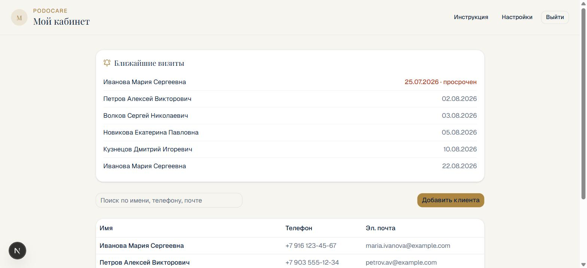
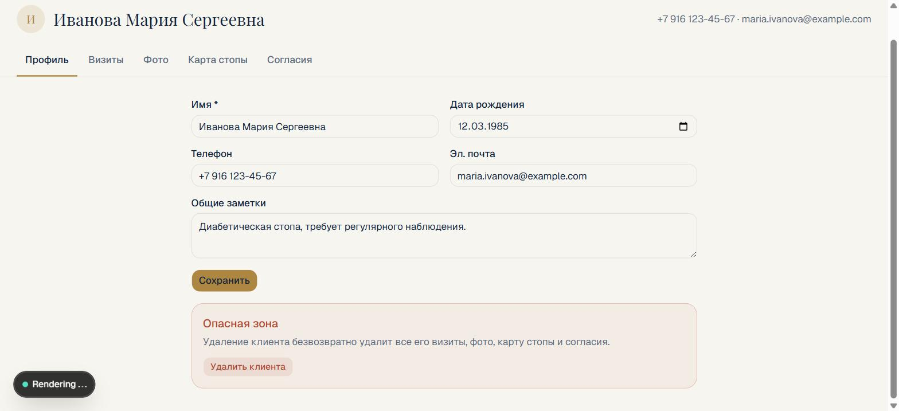

# PodoCare — mandantenfähige SaaS für podologische Praxen

> 🇬🇧 [English version](README.md) · 🌐 Live: **[podocare.app](https://podocare.app)**

**Ein kommerzielles, mandantenfähiges CRM für Fußpflege- und Podologiepraxen — im produktiven Einsatz, mit zahlenden Praxen darauf** — Architektur, Code, Deployment und Betrieb vollständig eigenverantwortlich von [Johannes Braun](https://github.com/DjonnnBraunnn).

Dies ist ein **Showcase-Repository**: ausgewählte Module und Architekturnotizen aus der privaten Produktiv-Codebasis. Das Produkt selbst ist Closed Source, weil es im Abo verkauft wird.

| | |
|---|---|
| **Status** | Im produktiven Einsatz. Echte Praxen, echte Patientenakten, täglicher Betrieb. |
| **Umfang der Codebasis** | ~77 000 Zeilen TypeScript · 148 SQL-Migrationen (~23 000 Zeilen) · 74 Testdateien, 1 336 Tests |
| **Oberfläche** | Russisch · Kasachisch · Englisch · Deutsch (2 304 Wörterbuchschlüssel je Sprache) |
| **Clients** | Web (installierbare PWA) + signierte Android-App |
| **Betrieben von** | Einer Person: Architektur, Code, Datenbank, Docker-Deployment, Server, Rufbereitschaft |

---

## Screenshots — das laufende System



*Startseite: Erinnerungen an anstehende Termine (überfällige hervorgehoben), Suche, Kundenliste. Demodaten.*



*Kundenprofil mit der Löschaktion in der Gefahrenzone — nur für Inhaber- und Admin-Rolle.*

---

## Was das System leistet

**Behandlungsdokumentation**
- Patientenakte mit vollständiger Behandlungshistorie — Beschwerden, Befund, erbrachte Leistungen, Verbrauchsmaterial, Folgetermin
- **Interaktive Fußkarte** — Befunde (Hornhaut, eingewachsene Nägel, Warzen, Risse) per Klick auf einer SVG-Fußsilhouette markieren, je Behandlung, mit Übernahme der vorherigen Markierungen
- **Foto-Vergleich vor und nach der Behandlung**, an Termin und Phase gebunden, in privatem Supabase Storage
- **Elektronische Einwilligung mit Unterschrift → PDF**, serverseitig gerendert und abgelegt
- Orthonyxie-Spangenverläufe, Sterilisationsprotokoll, Anamnese

**Praxisorganisation**
- Terminplan mit Spalten und Farben je Mitarbeiter, Arbeitszeitraster, Pausen, Dienstplan
- Online-Terminbuchung über eine öffentliche „digitale Visitenkarte" je Praxis
- Leistungen, Preise je Mitarbeiterkategorie, Lager, Kasse, Teilzahlungen, Lohn und Provision
- Auswertungen: Umsatz, Auslastung, Wirtschaftlichkeit je Leistung, Kundensegmente, freier Zeitraum
- **Automatisierte WhatsApp-Nachrichten** — Regeln „wem und wann", versendet über Baileys (~40 MB, ohne Headless-Chromium), Zeitzone je Praxis
- Web-Push-Benachrichtigungen

**Plattform**
- Mandantenfähig ab der ersten Migration: jede Registrierung legt einen isolierten `workspace` an
- Rollen (Inhaber / Admin / Fachkraft) mit einer Rechtematrix, die durch Tests geprüft wird, nicht per Augenschein
- Abonnements, Testphasen, Kulanzfristen, Platzgrenzen je Tarif, Betreiberkonsole
- Vier Oberflächensprachen, vier Erscheinungsbilder, hell und dunkel

---

## Technologie

| Ebene | Technik |
|---|---|
| Framework | Next.js 16 (App Router, Server Actions), React 19, TypeScript |
| Daten / Auth / Storage | Supabase — Postgres, Row Level Security, GoTrue, Storage — **selbst gehostet**, nicht das Cloud-Produkt |
| Styling | Tailwind CSS v4, shadcn/ui |
| PDF | `@react-pdf/renderer` |
| Nachrichten | Baileys (WhatsApp), Web Push |
| Android | Trusted Web Activity, signierter Release-Build |
| Deployment | Docker Compose, Nginx + Let's Encrypt, DigitalOcean, Umschaltung ohne Ausfallzeit |
| Tests | Vitest — 1 336 Tests, laufen vor jedem Push |

---

## Architektur

```
                    ┌───────────────────────────────────┐
                    │        Next.js (App Router)        │
                    │  Terminplan · Akte · Fußkarte      │
                    │  Einwilligungen · Kasse · Statistik│
                    └────────────────┬───────────────────┘
                                     │ Server Actions / PostgREST
                    ┌────────────────▼───────────────────┐
                    │             Supabase                │
                    │  Postgres + RLS · Auth · Storage    │
                    │  SECURITY-DEFINER-RPCs für den      │
                    │  öffentlichen Kontakt- und          │
                    │  Buchungsweg                        │
                    └─────────────────────────────────────┘
```

**Die Trennung liegt in der Datenbank, nicht in der Anwendung.** Jede Tabelle führt `workspace_id` und hat eine RLS-Policy; die Anwendung filtert nicht in einer `where`-Klausel, die sie vergessen könnte. Ein fehlendes `if` in einer React-Komponente kann keine fremde Patientenakte offenlegen, weil die Zeile Postgres gar nicht erst verlässt.

---

## Ausgewählte Module in diesem Repository

| Datei | Warum sie hier steht |
|---|---|
| [`supabase/schema_and_rls.sql`](supabase/schema_and_rls.sql) | Das mandantenfähige Schema und die RLS-Policies, die es durchsetzen |
| [`supabase/intake_rpc.sql`](supabase/intake_rpc.sql) | Der öffentliche Kontaktweg: eine eng geschnittene `SECURITY DEFINER`-Funktion statt `INSERT`-Recht für `anon` |
| [`src/app/foot-map-component.tsx`](src/app/foot-map-component.tsx) | Die interaktive SVG-Fußkarte |
| [`src/app/consent-pdf-document.tsx`](src/app/consent-pdf-document.tsx) | Unterschriebene Einwilligung → PDF, serverseitig |
| [`src/app/intake-actions.ts`](src/app/intake-actions.ts) | Server Actions hinter dem öffentlichen Formular |
| [`src/lib/subscription.ts`](src/lib/subscription.ts) | Abo-Status wird abgeleitet, nie gespeichert — ein gespeicherter Status ist ab Mitternacht falsch |
| [`src/lib/fetch-all.ts`](src/lib/fetch-all.ts) | Blättern über die stille 1 000-Zeilen-Grenze von PostgREST hinaus |
| [`src/lib/db-view-guard.test.ts`](src/lib/db-view-guard.test.ts) | Ein Test, der den Build bricht, wenn eine neue View ohne eigenen Filter hinzukommt |
| [`src/lib/public-lang.ts`](src/lib/public-lang.ts) | Sprache der öffentlichen Seiten: Auswahl → Browser-Header → Rückfallsprache |
| [`src/lib/landing-price.ts`](src/lib/landing-price.ts) | Ein Preis, zwei Währungen, entschieden durch die Sprache der Seite |
| [`Dockerfile`](Dockerfile) | Mehrstufiger Build, Standalone-Output von Next.js |

---

## Drei Dinge, die teuer gelernt wurden

**1. PostgREST schneidet bei 1 000 Zeilen ab und sagt nichts.**
Eine Auswertung, die ein Jahr an Behandlungen in JavaScript summierte, summierte still die ersten tausend. Kein Fehler, keine Warnung, kein Hinweis auf ein Teilergebnis — die Zahl ist einfach falsch, und zwar in der Richtung, die plausibel aussieht. Alles, was in JS gezählt wird, läuft jetzt über [`fetchAllRows`](src/lib/fetch-all.ts): ausdrückliches Blättern, mit erzwungenem `.order()`, weil Blättern ohne stabile Sortierung Zeilen doppelt liefert und andere auslässt.

**2. Row Level Security wandert nicht durch eine View.**
Eine View, die einer privilegierten Rolle gehört, läuft mit deren Rechten: die Policies der darunterliegenden Tabellen greifen nicht. So wurden Spangenverläufe einer Praxis für eine andere sichtbar. Jede View trägt jetzt ihren eigenen Mandantenfilter in der `where`-Klausel, und [`db-view-guard.test.ts`](src/lib/db-view-guard.test.ts) liest die Migrationen und bricht den Build, wenn eine neue View ohne ihn auftaucht. Die Korrektur war eine Zeile; sie zu finden, kostete einen Tag.

**3. Ein Speicherlimit je Container ist kein Detail.**
Zwei Produkte teilen sich einen Server. Limits sind das Einzige, was den Absturz des einen für das andere überlebbar macht — und die Asymmetrie ist real: Wer kein Limit hat, reißt im Zweifel beide mit. Dasselbe gilt für die Log-Rotation (Dockers eigenes `max-size`, niemals ein externes `logrotate` — `copytruncate` zerstört `docker logs` für jeden Container auf dem Host) und für `prune` in Cron-Skripten, das immer nach Projekt-Label gefiltert sein muss.

---

## Kontakt

**braunjohannes595@gmail.com** · [LinkedIn](https://www.linkedin.com/in/johannes-braun-dev/) — DE 🇩🇪 / RU / EN
