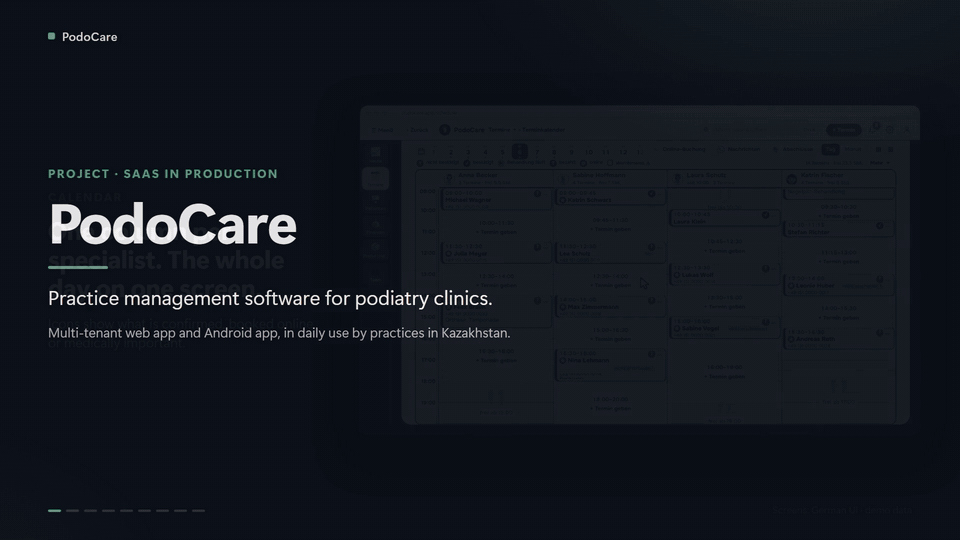
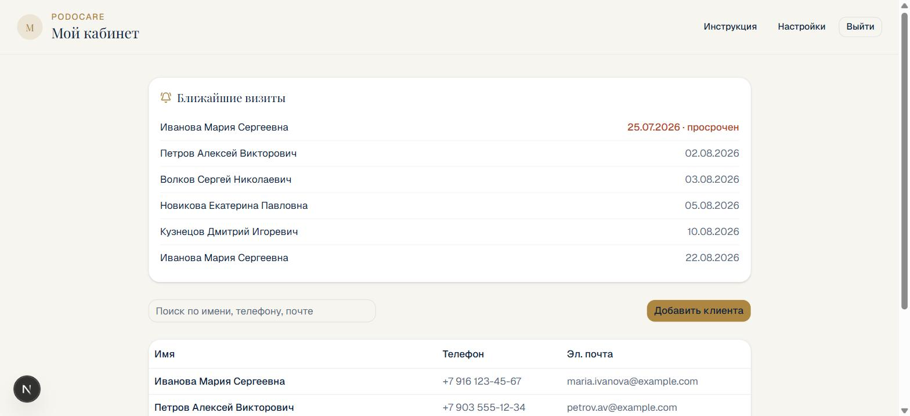
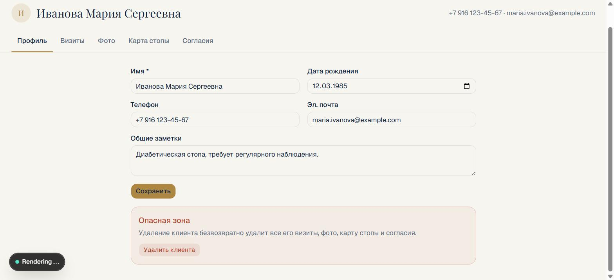

# PodoCare — Multi-Tenant SaaS for Podiatry Practices

> 🇩🇪 [Deutsche Fassung](README.de.md) · 🌐 Live: **[podocare.app](https://podocare.app)**

**A commercial multi-tenant CRM for podiatry practices — in production, with paying clinics on it** — designed, built, deployed and operated end-to-end by [Johannes Braun](https://github.com/DjonnnBraunnn).

This is a **showcase repository**. It holds selected modules and architecture notes from the private production codebase; the product itself is closed-source.

| | |
|---|---|
| **Status** | In production. Real clinics, real patient records, daily use. |
| **Scale of the codebase** | ~77 000 lines of TypeScript · 500+ SQL migrations · 700+ test files, 10 000+ tests |
| **Interface** | Russian · Kazakh · English · German (2 304 dictionary keys per language) |
| **Clients** | Web (installable PWA) + a signed Android app |
| **Operated by** | One person: architecture, code, database, Docker deployment, server, on-call |

---

## Demo (42 s)

[](assets/podocare-demo-en.mp4)

*A short tour without sound: calendar, booking, patient record, foot map, online booking, WhatsApp automation, mobile app. German interface, demo data.*
*Full video: [MP4, 1920×1080](assets/podocare-demo-en.mp4) · [vertical 1080×1920](assets/podocare-demo-en-vertical.mp4) · more projects in the [project overview](https://github.com/DjonnnBraunnn).*

---

## Screenshots — the live system



*Dashboard: upcoming-visit reminders (overdue highlighted), search, client list. Demo data.*



*Client profile with the danger-zone delete action, gated to owner/admin roles.*

---

## What the system does

**Clinical record**
- Client card with full visit history — complaints, diagnosis, services rendered, consumables, next visit
- **Interactive foot map** — click-to-mark findings (calluses, ingrown nails, warts, cracks) on an SVG foot silhouette, per visit, with a per-visit mirror of the previous marks
- **Before/after photo comparison**, tied to visit and phase, in private Supabase Storage
- **E-signature informed consent → PDF**, rendered and stored server-side
- Orthonyxia (bracing) courses, sterilisation log, anamnesis

**Running a practice**
- Schedule with per-specialist columns and colours, working-hours grids, breaks, shift table
- Online booking through a public per-workspace "digital business card"
- Services, price lists per specialist category, stock, till, part-payments, salary and commission
- Statistics: revenue, load, service economics, client segments, custom date ranges
- **Automated WhatsApp messaging** — rules for "who and when", sent by Baileys (~40 MB, no headless Chromium), workspace-level time zones
- Web Push notifications

**Platform**
- Multi-tenant from the first migration: every signup provisions an isolated `workspace`
- Roles (owner / admin / specialist) with a permissions matrix verified by tests, not by eye
- Subscriptions, trials, grace periods, seat limits per tier, a platform-operator console
- Four interface languages, four visual skins, light/dark

---

## Tech stack

| Layer | Tech |
|---|---|
| Framework | Next.js 16 (App Router, Server Actions), React 19, TypeScript |
| Data / Auth / Storage | Supabase — Postgres, Row-Level Security, GoTrue, Storage — **self-hosted**, not the cloud product |
| Styling | Tailwind CSS v4, shadcn/ui |
| PDF | `@react-pdf/renderer` |
| Messaging | Baileys (WhatsApp), Web Push |
| Android | Trusted Web Activity, signed release build |
| Deployment | Docker Compose, Nginx + Let's Encrypt, DigitalOcean, zero-downtime port switch |
| Tests | Vitest — 10 000+ tests in 700+ files, run before every push |

---

## Architecture

```
                    ┌───────────────────────────────────┐
                    │        Next.js (App Router)        │
                    │  schedule · client card · foot map │
                    │  consents · till · statistics      │
                    └────────────────┬───────────────────┘
                                     │ Server Actions / PostgREST
                    ┌────────────────▼───────────────────┐
                    │             Supabase                │
                    │  Postgres + RLS · Auth · Storage    │
                    │  SECURITY DEFINER RPCs for public   │
                    │  intake and booking                 │
                    └─────────────────────────────────────┘
```

**Isolation lives in the database, not in the application.** Every table carries `workspace_id` and an RLS policy; the app never filters by workspace in a `where` clause it could forget. A dropped `if` in a React component cannot leak another clinic's patient records, because the row never leaves Postgres.

---

## Selected modules in this repo

| File | Why it is here |
|---|---|
| [`supabase/schema_and_rls.sql`](supabase/schema_and_rls.sql) | The multi-tenant schema and the RLS policies that enforce it |
| [`supabase/intake_rpc.sql`](supabase/intake_rpc.sql) | The public lead-capture path: a narrow `SECURITY DEFINER` function instead of opening `INSERT` to `anon` |
| [`src/app/foot-map-component.tsx`](src/app/foot-map-component.tsx) | The interactive SVG foot map |
| [`src/app/consent-pdf-document.tsx`](src/app/consent-pdf-document.tsx) | Signed consent → PDF, server-side |
| [`src/app/intake-actions.ts`](src/app/intake-actions.ts) | Server actions behind the public intake form |
| [`src/lib/subscription.ts`](src/lib/subscription.ts) | Subscription state derived, never stored — a stored status is wrong from midnight until a job refreshes it |
| [`src/lib/fetch-all.ts`](src/lib/fetch-all.ts) | Paging past PostgREST's silent 1 000-row ceiling |
| [`src/lib/db-view-guard.test.ts`](src/lib/db-view-guard.test.ts) | A test that fails the build when a new database view is added without its own filter |
| [`src/lib/public-lang.ts`](src/lib/public-lang.ts) | Language of the public pages: choice → browser header → fallback |
| [`src/lib/landing-price.ts`](src/lib/landing-price.ts) | One price, two currencies, picked by the language of the page |
| [`Dockerfile`](Dockerfile) | Multi-stage build, standalone Next.js output |

---

## Three things that were learned the expensive way

**1. PostgREST truncates at 1 000 rows and says nothing about it.**
A report that summed a year of visits in JavaScript quietly summed the first thousand. There is no error, no warning, no partial-result flag — the number is simply wrong, and it is wrong in the direction that looks plausible. Everything counted in JS now goes through [`fetchAllRows`](src/lib/fetch-all.ts), which pages explicitly and requires an `.order()`, because paging without a stable sort silently repeats and drops rows.

**2. Row-Level Security does not travel through a view.**
A view owned by a privileged role runs with that role's rights: the policies on the tables underneath are not applied. That is how one workspace's orthonyxia courses became visible to another. Every view now carries its own workspace filter in its `where` clause, and [`db-view-guard.test.ts`](src/lib/db-view-guard.test.ts) reads the migrations and fails the build if a new view appears without one. The fix is one line; finding it took a day.

**3. A memory limit per container is not a detail.**
Two products share one droplet. Limits are the only thing that makes one of them crashing survivable for the other — and the asymmetry is real: whichever side has no limit is the side that takes both down. The same applies to log rotation (Docker's own `max-size`, never an external `logrotate` — `copytruncate` breaks `docker logs` for every container on the host) and to `prune` in cron scripts, which must always be filtered by project label.

---

## Contact

**braunjohannes595@gmail.com** · [LinkedIn](https://www.linkedin.com/in/johannes-braun-dev/) — DE 🇩🇪 / RU / EN
